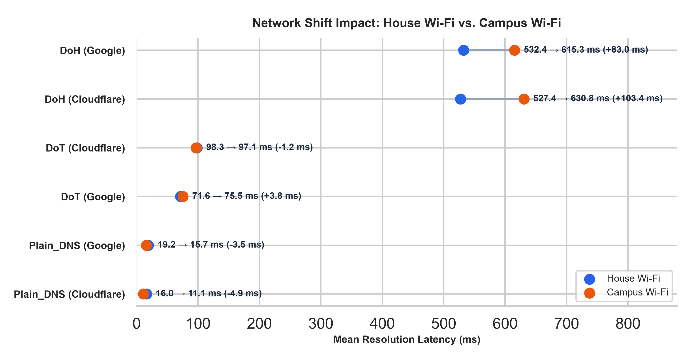
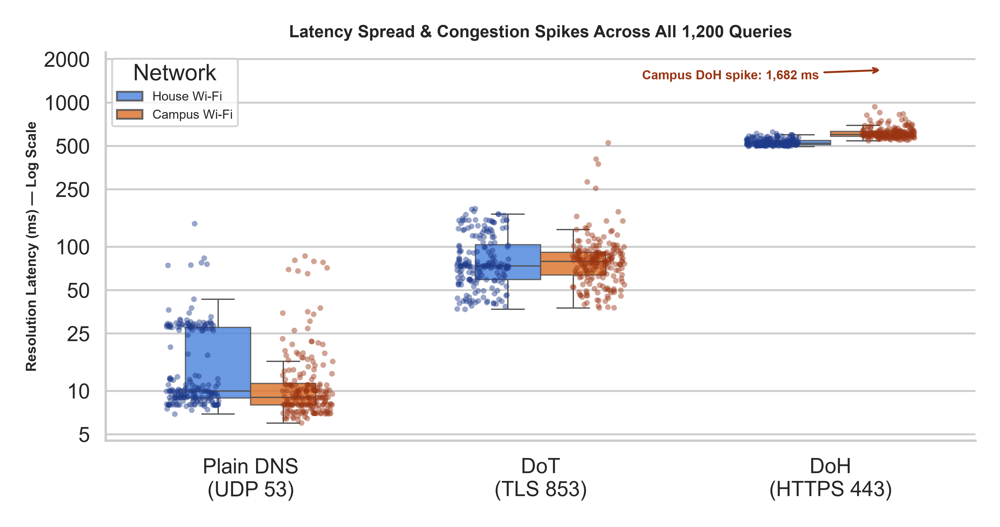
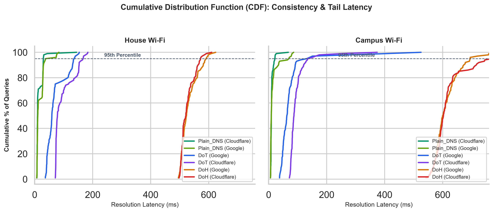
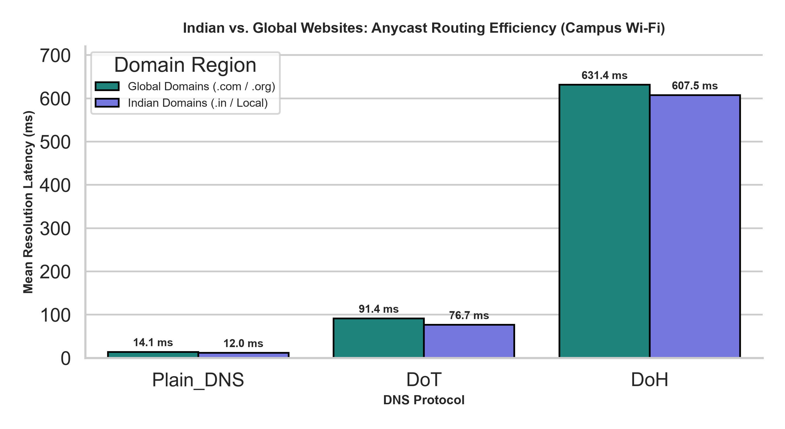

# Empirical Performance & Privacy Analysis of Encrypted DNS (Plain DNS vs. DoT vs. DoH)

An empirical Computer Networks benchmarking study evaluating resolution latency, tail stability, and protocol overhead across **Plain DNS (UDP 53)**, **DNS-over-TLS (DoT, TCP 853)**, and **DNS-over-HTTPS (DoH, TCP 443)** using **Google (`8.8.8.8`)** and **Cloudflare (`1.1.1.1`)** public resolvers across **House Wi-Fi** and **Campus Wi-Fi** environments.

---

## 1. Project Overview & Motivation

Traditional DNS transmits domain queries in unencrypted plaintext over UDP Port 53, exposing user browsing activity to local network observers, ISPs, and on-path attackers. Modern encrypted DNS standards—**DoT (RFC 7858)** and **DoH (RFC 8484)**—protect query confidentiality using TLS, but introduce cryptographic handshake and transport framing overhead.

This project measures that real-world **privacy vs. latency trade-off** across residential broadband and shared institutional networks.

### Protocol Architecture Comparison

| Feature | Plain DNS | DNS-over-TLS (DoT) | DNS-over-HTTPS (DoH) |
| :--- | :--- | :--- | :--- |
| **Transport & Port** | UDP Port 53 | TCP + TLS Port 853 | TCP + HTTPS Port 443 |
| **Payload Encryption** | None (Plaintext) | Encrypted Wire-Format | Encrypted HTTP/JSON |
| **Traffic Visibility** | Domain names readable | Identified as DNS traffic | Blended with standard HTTPS |
| **Firewall Traversal** | Open by default | Can be blocked on Port 853 | Difficult to block (Port 443) |

---

## 2. Experimental Methodology

* **Target Dataset:** 20 high-traffic domains (mix of Indian regional domains such as `irctc.co.in`, `sbi.co.in`, `flipkart.com`, `hotstar.com` and global domains such as `google.com`, `github.com`, `netflix.com`, `cloudflare.com`).
* **Resolvers Evaluated:** Cloudflare (`1.1.1.1`) and Google (`8.8.8.8`).
* **Sampling Design:** 5 independent iterations per domain $\times$ 3 protocols $\times$ 2 resolvers = **600 queries per network** (**1,200 total valid measurements**, 0% packet loss).
* **Network Environments:**
  1. **House Wi-Fi:** Dedicated residential broadband connection.
  2. **Campus Wi-Fi:** Shared institutional student network with institutional NAT/routing load.
* **Packet Inspection:** Validated plaintext vs. encrypted wire captures using **Wireshark** (`dns_traffic_evidence.pcapng`).

---

## 3. Empirical Results Summary

| Protocol | DNS Provider | House Wi-Fi Mean (Median) | Campus Wi-Fi Mean (Median) | Network Shift ($\Delta$) |
| :--- | :--- | :--- | :--- | :--- |
| **Plain DNS** | Cloudflare (`1.1.1.1`) | **15.99 ms** (9.74 ms) | **11.06 ms** (9.02 ms) | -4.93 ms |
| **Plain DNS** | Google (`8.8.8.8`) | **19.17 ms** (10.76 ms) | **15.70 ms** (9.01 ms) | -3.47 ms |
| **DoT (TLS)** | Google (`8.8.8.8`) | **71.61 ms** (59.26 ms) | **75.45 ms** (63.26 ms) | +3.84 ms |
| **DoT (TLS)** | Cloudflare (`1.1.1.1`) | **98.32 ms** (78.48 ms) | **97.07 ms** (87.34 ms) | -1.25 ms |
| **DoH (HTTPS)** | Google (`8.8.8.8`) | **532.37 ms** (523.59 ms) | **615.33 ms** (600.89 ms) | +82.96 ms |
| **DoH (HTTPS)** | Cloudflare (`1.1.1.1`) | **527.41 ms** (521.36 ms) | **630.78 ms** (602.86 ms) | +103.37 ms |

---

## 4. Visual Analysis & Key Findings

### A. Network Shift Impact (House Wi-Fi vs. Campus Wi-Fi)

* **Finding:** Plain DNS (`~11–19 ms`) and DoT (`~71–98 ms`) remain virtually unaffected when moving from residential broadband to Campus Wi-Fi. In contrast, DoH degrades by **+83.0 ms** (Google) to **+103.4 ms** (Cloudflare) due to HTTPS connection setup overhead under shared institutional network congestion.

### B. Latency Spread & Congestion Spikes

* **Finding:** Across all 1,200 queries, Campus Wi-Fi introduces significant tail outliers in encrypted traffic, peaking at **1,681.75 ms** for Cloudflare DoH compared to a tight upper bound of **624.17 ms** on House Wi-Fi.

### C. Tail Latency & Consistency (CDF Analysis)

* **Finding:** 95% of DoT queries resolve under **~130–170 ms** across both networks, offering a strong balance between encryption and low latency. DoH requires **~580–750 ms** at the 95th percentile due to HTTP/JSON framing overhead.

### D. Anycast Routing Efficiency (Indian vs. Global Domains)

* **Finding:** Regional Indian domains (`.in` / local services) resolve slightly faster than global domains across all three protocols (`12.0 ms` vs. `14.1 ms` on Plain DNS; `76.7 ms` vs. `91.4 ms` on DoT), reflecting effective local Anycast Points-of-Presence (PoPs) deployed by Google and Cloudflare in India.

---

## 5. Repository Structure

```text
├── test_dns.py                        # Baseline Plain DNS (UDP 53) test script
├── test_doh.py                        # Baseline DNS-over-HTTPS (TCP 443) test script
├── test_dot.py                        # Baseline DNS-over-TLS (TCP 853) test script
├── benchmark.py                       # Automated multi-domain benchmarking & Excel report generator
├── make_charts.py                     # Matplotlib/Seaborn visualization pipeline
├── results_house wifi.csv             # Raw benchmark dataset (House Wi-Fi, 600 records)
├── results_campus wifi.csv            # Raw benchmark dataset (Campus Wi-Fi, 600 records)
├── DNS_Report_House WiFi.xlsx         # Formatted Excel workbook (Summary, Matrix, Raw Data)
├── DNS_Report_Campus WiFi.xlsx        # Formatted Excel workbook (Summary, Matrix, Raw Data)
├── dns_traffic_evidence.pcapng        # Wireshark packet capture proving encryption
├── chart1_network_shift_dumbbell.png  # Network shift dumbbell plot
├── chart2_distribution_boxplot.png    # Log-scale boxplot & outlier distribution
├── chart3_cdf_stability.png           # Cumulative Distribution Function (CDF) curves
├── chart4_indian_vs_global.png        # Regional Anycast routing comparison
└── README.md                          # Project documentation